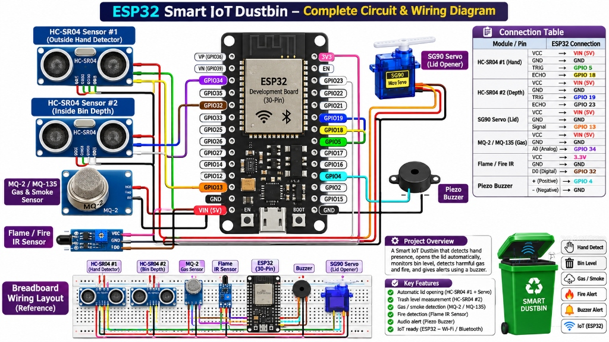

# 🗑️ Smart IoT Dustbin with ESP32

[](https://www.espressif.com/)
[](https://www.arduino.cc/)
[](https://isocpp.org/)
[](LICENSE)
[]()

An intelligent, contactless, IoT-enabled Smart Dustbin built with **ESP32**, dual ultrasonic sensors, gas & smoke monitoring, flame detection, an automated 90° servo lid mechanism, and an embedded real-time web dashboard accessible via standalone Wi-Fi Access Point.

---

## 📸 Circuit & Wiring Diagram

The complete hardware schematic and breadboard wiring layout for all sensors and actuators connected to the ESP32:



---

## ⚡ Key Features

- **👐 Automatic Contactless Lid Opening**: Outer ultrasonic sensor detects approaching hand within **15 cm** and automatically swings the lid open to 90°.
- **⏱️ 10-Second Smart Auto-Close**: Holds the lid open for exactly 10 seconds, then closes automatically.
- **🛡️ Anti-Vibration & Lockout Protection**: Ignores hand sensor during the 10-second open state and includes a 2-second cooldown to completely prevent servo jitter/vibration.
- **📊 Real-time Bin Fill Level**: Inside ultrasonic sensor continuously calculates waste fill percentage and remaining depth in centimeters.
- **💨 Pure Air & Smoke Density Sensing**: MQ gas sensor with auto-calibrated room baseline measuring smoke density (PPM) and Clean Air %.
- **🔥 Fire & Flame Detection**: IR flame sensor triggers instant audio buzzer alarm on flame detection.
- **🌐 Embedded Web Dashboard**: Built-in Wi-Fi Hotspot (`SmartDustbin`) serving a dark-themed, mobile-responsive dashboard at `http://192.168.4.1` with live sensor gauges and manual open/close controls.
- **⏱️ Non-Blocking Architecture**: Completely non-blocking execution using independent `millis()` timers for smooth multitasking without freezing.

---

## 🏗️ System Architecture

```mermaid
flowchart TD
    subgraph SENSORS["Sensing Layer (Inputs)"]
        U1["Ultrasonic 1 (Hand Detector)<br/>Trig: GPIO 5 | Echo: GPIO 18"]
        U2["Ultrasonic 2 (Fill Level)<br/>Trig: GPIO 19 | Echo: GPIO 23"]
        MQ["MQ Gas / Smoke Sensor<br/>Analog: GPIO 34 (ADC)"]
        IR["IR Flame Sensor<br/>Digital: GPIO 32"]
    end

    subgraph MCU["Processing Core (ESP32 Dev Board)"]
        CPU["ESP32 Dual-Core CPU"]
        TIMERS["Non-Blocking Timer Loops (millis)<br/>• Hand Read: 120ms<br/>• Fill Depth: 200ms<br/>• Gas & Fire: 300ms"]
        LOGIC["Decision Engine<br/>• Proximity Trigger <= 15cm<br/>• 10s Open Hold Timer<br/>• Cooldown Lockout<br/>• Gas Baseline Calibration"]
        AP["SoftAP Hotspot<br/>SSID: 'SmartDustbin'"]
        WS["HTTP Web Server (Port 80)<br/>REST API: /api/stats, /open, /close"]
    end

    subgraph ACTUATORS["Actuators & Alerts"]
        SERVO["SG90 / MG995 Servo Motor<br/>GPIO 13 (PWM: 10° - 100°)"]
        BUZZER["Piezo Buzzer<br/>GPIO 4 (Frequency Tones)"]
    end

    subgraph CLIENT["User Interface"]
        DASH["Web Dashboard (Phone / PC Browser)<br/>• Air Cleanliness % & PPM<br/>• Fill Level % & Depth Left<br/>• Flame Status & Alerts<br/>• Remote Manual Lid Controls"]
    end

    %% Sensor Data Flow
    U1 -->|Echo Duration| CPU
    U2 -->|Echo Duration| CPU
    MQ -->|ADC Voltage| CPU
    IR -->|Digital Alert| CPU

    %% Internal Processing
    CPU <--> TIMERS
    CPU <--> LOGIC
    LOGIC --> AP
    AP --> WS

    %% Actuation
    LOGIC -->|PWM Angle Command| SERVO
    LOGIC -->|Alarm Tones| BUZZER

    %% Web UI
    WS <==>|HTTP / JSON (500ms Poll)| DASH
```

---

## 🔌 Hardware Pinout & Connection Table

| Module / Component | Component Pin | ESP32 Pin | Wire Color (Ref) | Description / Function |
|:---|:---|:---|:---|:---|
| **HC-SR04 #1 (Hand Sensor)** | VCC | **VIN (5V)** | Red | Sensor Power Supply |
| | GND | **GND** | Black | Ground |
| | TRIG | **GPIO 5 (D5)** | Green | Trigger Pulse Output |
| | ECHO | **GPIO 18 (D18)** | Yellow | Echo Return Pulse Input |
| **HC-SR04 #2 (Fill Depth)** | VCC | **VIN (5V)** | Red | Sensor Power Supply |
| | GND | **GND** | Black | Ground |
| | TRIG | **GPIO 19 (D19)** | Blue | Trigger Pulse Output |
| | ECHO | **GPIO 23 (D23)** | White | Echo Return Pulse Input |
| **Servo Motor (SG90/MG995)** | VCC | **VIN (5V)** | Red | 5V Power Supply |
| | GND | **GND** | Brown/Black | Common Ground |
| | Signal | **GPIO 13 (D13)** | Orange | PWM Control (10° closed, 100° open) |
| **MQ-2 / MQ-135 Gas Sensor** | VCC | **VIN (5V)** | Red | Heater + Module Power |
| | GND | **GND** | Black | Ground |
| | A0 (Analog) | **GPIO 34** | Purple | ADC Input for Smoke Density |
| **IR Flame / Fire Sensor** | VCC | **3.3V / VIN** | Pink | Module Power |
| | GND | **GND** | Black | Ground |
| | D0 (Digital) | **GPIO 32** | Brown | Active LOW Fire Trigger |
| **Piezo Buzzer** | (+) Positive | **GPIO 4 (D4)** | Cyan | Audio Tone Output |
| | (-) Ground | **GND** | Black | Ground |

---

## 💻 Software & Libraries

The firmware is written for the Arduino IDE / PlatformIO framework.

### Required Arduino Libraries:
1. **ESP32Servo** by Kevin Harrington (Install via Arduino Library Manager)
2. **WiFi.h** (Built-in ESP32 core)
3. **WebServer.h** (Built-in ESP32 core)

---

## 🚀 Getting Started

### 1. Arduino IDE Setup
1. Open **Arduino IDE**.
2. Go to `Tools` > `Board` > `ESP32 Arduino` and select **ESP32 Dev Module**.
3. Install the **ESP32Servo** library from `Sketch` > `Include Library` > `Manage Libraries...`.

### 2. Uploading the Code
1. Connect your ESP32 board to your computer via micro-USB.
2. Select the correct **COM Port** from `Tools` > `Port`.
3. Open `Smart_Dustbin_IoT.ino`.
4. Click **Upload** (Hold the `BOOT` button on ESP32 if the upload gets stuck on `Connecting......`).

### 3. Connecting to the Web Dashboard
1. Once powered, ESP32 broadcasts a Wi-Fi hotspot:
   - **SSID**: `SmartDustbin`
   - **Password**: *None (Open Wi-Fi)*
2. Connect your phone or laptop to `SmartDustbin`.
3. Open any web browser and navigate to:
   ```
   http://192.168.4.1
   ```
4. You will see live gauges for **Air Quality**, **Fill Level**, **Fire Status**, and **Remote Controls**.

---

## 🛠️ REST API Endpoints

The internal WebServer exposes the following endpoints for integration:

| Endpoint | Method | Response / Action |
|:---|:---|:---|
| `/` | `GET` | Serves the full HTML5/CSS3/JavaScript responsive Dashboard. |
| `/api/stats` | `GET` | Returns live JSON: `{"fill":0,"space_cm":30,"hand_cm":12,"clean_air":98,"ppm":35,"fire":false,"lid":false}` |
| `/open` | `GET` | Manually triggers the servo to rotate 90° and hold for 10s. |
| `/close` | `GET` | Manually forces the servo to close immediately. |

---

## 💡 Troubleshooting & Hardware Tips

- **Servo Buzzing / Stalling**: Standard SG90 servos can draw up to 500mA-1A peak when moving. Power the ESP32 through a quality 5V 2A micro-USB adapter, or provide external 5V power to the servo with a shared common ground (`GND`).
- **Ultrasonic Inaccurate Readings**: Ensure HC-SR04 VCC is connected to `VIN` (5V), not 3.3V, as HC-SR04 requires 5V to fire ultrasonic transducers properly.
- **Smoke Baseline Calibration**: On every boot, the firmware samples the first 5 readings to set a dynamic room baseline, preventing false positives in different environments.

---

## 📜 License

This project is licensed under the [MIT License](LICENSE).
